# User Experience Design

**Worn** is a mobile-first digital wardrobe tracker. Users catalog their clothing, log each time they wear an item, and see the real **cost-per-wear** of everything they own (cost-per-wear = price ÷ total wears).

This document contains the app map and the wireframe diagrams for the Minimum Viable Product (MVP).

## Contents

- [Prototype](#prototype)
- [App Map](#app-map)
- [Wireframes](#wireframes)
  - [Onboarding](#onboarding): Welcome, Sign Up, Log In
  - [Closet](#closet): Closet, Add Item, Camera / Photo Upload, Item Detail, Edit Item, Bulk-Log Past Wears
  - [Dashboard](#dashboard): Dashboard, Closet Summary, Item Rankings, Spend by Category
  - [Profile](#profile): Profile / Settings
- [Source Files](#source-files)

---

## Prototype

A clickable mobile prototype built from these wireframes is available in Figma:

**[View the Worn prototype](https://www.figma.com/proto/fjQOCQylZdGEmo6aVZAhd7/Worn-Wireframes?node-id=1-24&starting-point-node-id=1-24)**

The prototype starts on the Welcome screen. Every button, link, and tab that moves the user to another screen is clickable.

---

## App Map

The app map shows the hierarchy of screens in Worn. The app has two sections:

- **Onboarding (logged out):** the screens a user sees before signing in.
- **Main App (tab bar):** three tabs that are always visible at the bottom of the screen: **Closet**, **Dashboard**, and **Profile**. Every other screen is a child of one of these tabs.

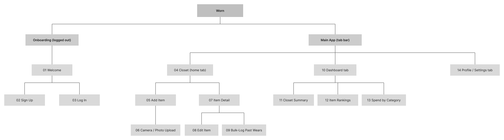

---

## Wireframes

All wireframes use a mobile layout of the same width. Gray boxes mark where photos and images will appear. Placeholder text such as `[Item name]`, `$X`, `#`, and `[date]` marks where real user data will appear.

### Onboarding

#### 01 Welcome

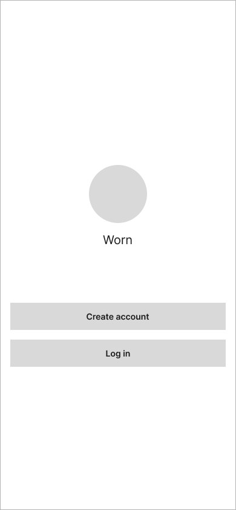

**Purpose:** The first screen a logged-out user sees. It introduces the app and lets the user either create an account or log in.

- **Create account** opens the Sign Up screen.
- **Log in** opens the Log In screen.
- A user who is already logged in skips this screen and goes straight to the Closet.

#### 02 Sign Up

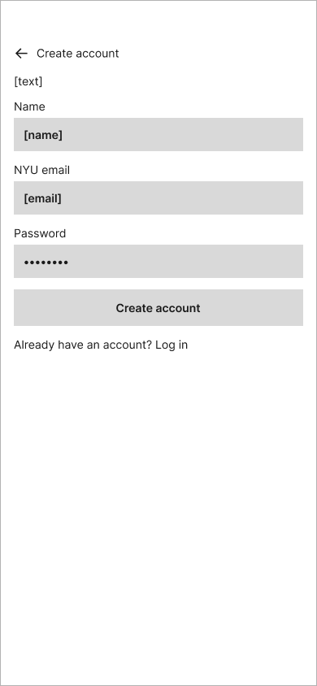

**Purpose:** Lets a new user create an account with their name, email, and password so their closet is saved and private.

- After a successful sign-up, the user lands on the Closet screen.
- The link at the bottom switches to the Log In screen for users who already have an account.

#### 03 Log In

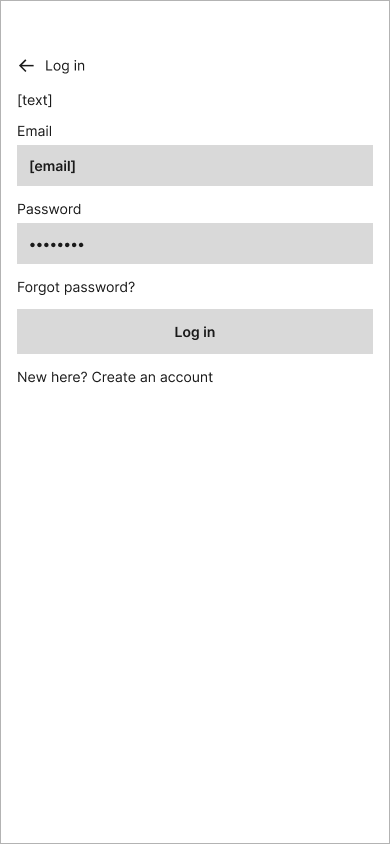

**Purpose:** Lets a returning user sign in with their email and password.

- After a successful log-in, the user lands on the Closet screen.
- The link at the bottom switches to the Sign Up screen.

---

### Closet

#### 04 Closet

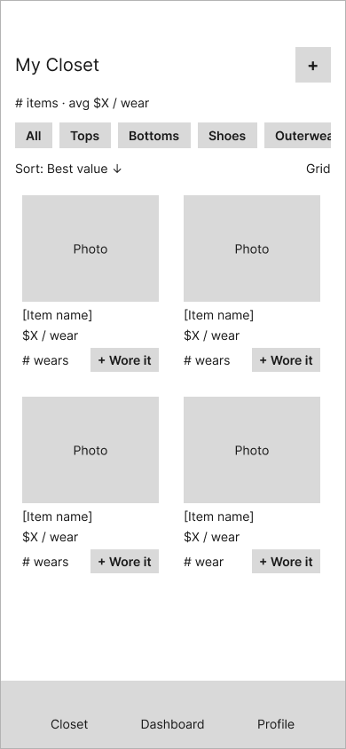

**Purpose:** The home screen. Shows every item the user owns in a photo grid, with each item's cost-per-wear and number of wears.

- **+ Wore it** on each card logs a wear for that item with today's date in one tap, without leaving the Closet. The card's wear count and cost-per-wear update right away.
- Tapping anywhere else on a card opens that item's **Item Detail** screen.
- The **+** button in the top right opens **Add Item**.
- The category buttons (All, Tops, Bottoms, Shoes, Outerwear) filter the grid. The row of categories scrolls sideways.
- **Sort** changes the order of the grid (for example, best value first or most worn first).
- The summary line under the title shows the total number of items and the average cost-per-wear across the whole closet.

#### 05 Add Item

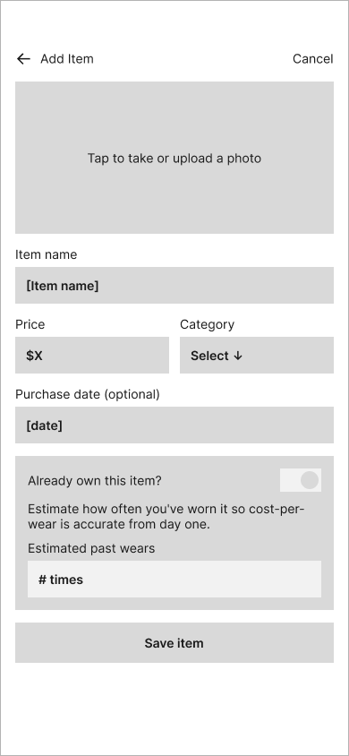

**Purpose:** Lets the user add a new piece of clothing to their closet.

- Tapping the photo area opens **Camera / Photo Upload**.
- Item name, price, and category are required. Purchase date is optional.
- **Already own this item?** is a toggle for clothes the user owned before they started using Worn. When it is on, the user enters a rough number of past wears (for example, "about 15 times"). This gives the item a realistic cost-per-wear immediately instead of starting at zero wears.
- **Save item** adds the item and returns to the Closet. **Cancel** or the back arrow returns to the Closet without saving.

#### 06 Camera / Photo Upload

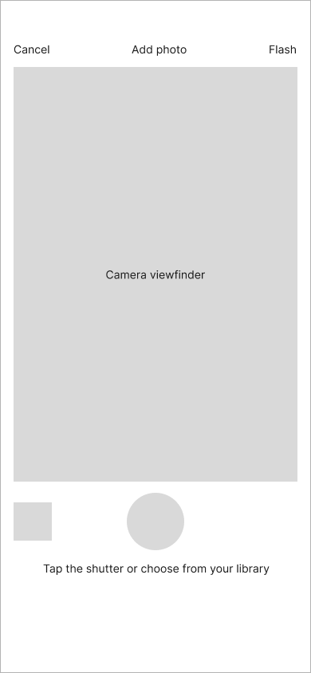

**Purpose:** Lets the user take a photo of an item or pick one from their phone's photo library.

- The large round button takes a photo. The small square button opens the photo library.
- After a photo is taken or chosen, the user returns to Add Item with the photo filled in.
- **Cancel** returns to Add Item without a photo.

#### 07 Item Detail

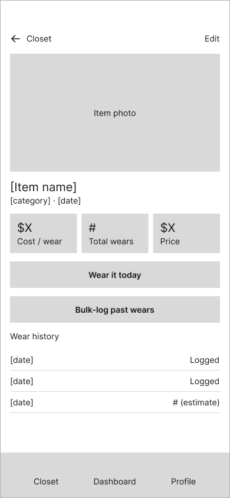

**Purpose:** Shows everything about one item: its photo, category, purchase date, cost-per-wear, total wears, price, and wear history.

- **Wear it today** logs a wear with today's date, the same as **+ Wore it** on the Closet screen.
- **Bulk-log past wears** opens the Bulk-Log Past Wears screen.
- **Edit** in the top right opens the Edit Item screen.
- **Wear history** lists each logged wear by date. Estimated wears from bulk-logging are shown on their own line marked "(estimate)" so they are never confused with exact daily logs.
- If an item has no wears yet, cost-per-wear shows "No wears yet" instead of dividing by zero.

#### 08 Edit Item

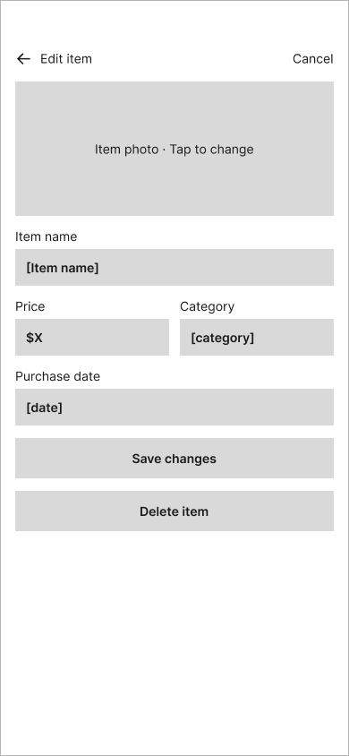

**Purpose:** Lets the user fix an item's details or remove an item they no longer own.

- Tapping the photo lets the user replace it.
- **Save changes** returns to Item Detail with the updated information. Changing the price recalculates cost-per-wear.
- **Delete item** removes the item and its wear history and returns to the Closet.
- **Cancel** or the back arrow returns to Item Detail without saving.

#### 09 Bulk-Log Past Wears

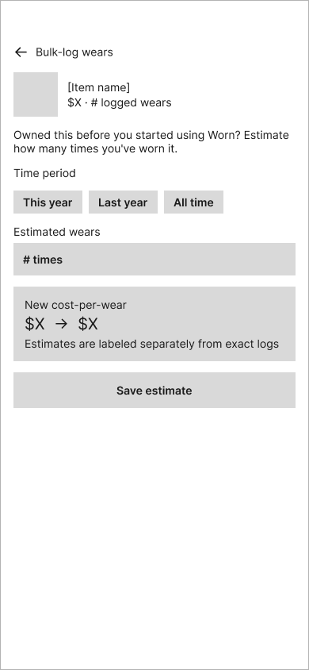

**Purpose:** Lets the user add an estimated number of past wears to an item that is already in their closet.

- The user picks a time period (This year, Last year, or All time) and enters an estimated number of wears.
- **New cost-per-wear** previews how the estimate will change the item's cost-per-wear before the user saves it.
- Estimates are stored separately from exact daily logs and are labeled as estimates in the wear history.
- **Save estimate** returns to Item Detail.

---

### Dashboard

#### 10 Dashboard

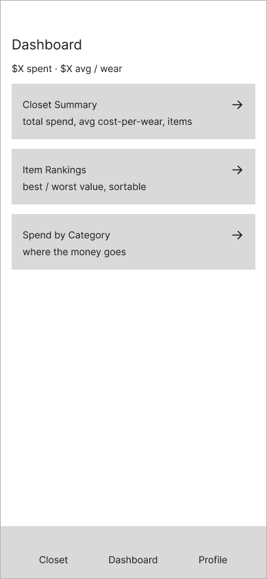

**Purpose:** The starting point for understanding the value of the user's closet. It shows total spend and average cost-per-wear at the top, then links to three detailed views.

- Each of the three boxes opens its own screen: **Closet Summary**, **Item Rankings**, and **Spend by Category**.

#### 11 Closet Summary

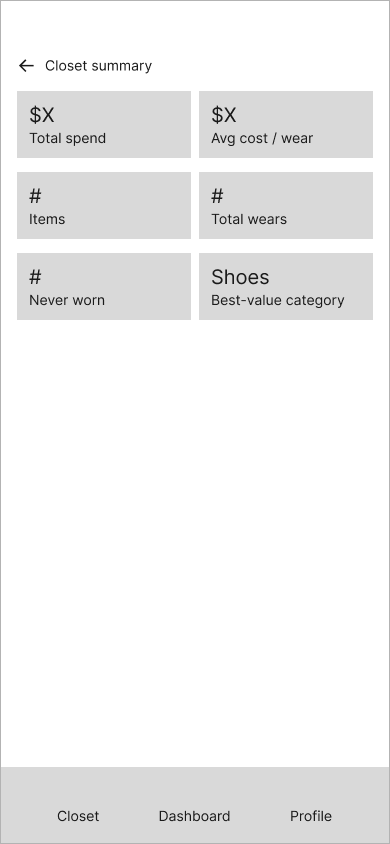

**Purpose:** Shows the big-picture stats for the whole closet: total spend, average cost-per-wear, number of items, total wears, number of items never worn, and the category with the best value.

- The back arrow returns to the Dashboard.

#### 12 Item Rankings

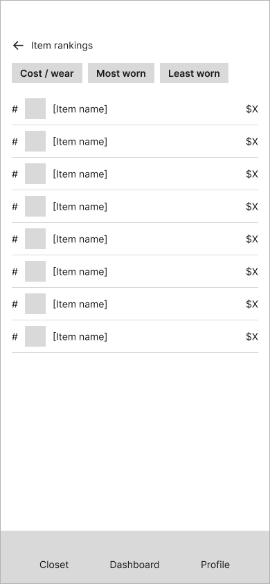

**Purpose:** Ranks every item so the user can quickly see their best-value and least-used pieces.

- The three buttons at the top change the ranking: **Cost / wear** (lowest first), **Most worn**, or **Least worn**.
- Tapping any row opens that item's Item Detail screen.

#### 13 Spend by Category

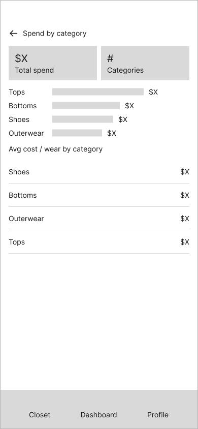

**Purpose:** Shows where the user's clothing money goes, broken down by category.

- The bar chart compares total spend in each category. Longer bars mean more money spent.
- The list below shows the average cost-per-wear for each category, ordered from best value to worst.

---

### Profile

#### 14 Profile / Settings

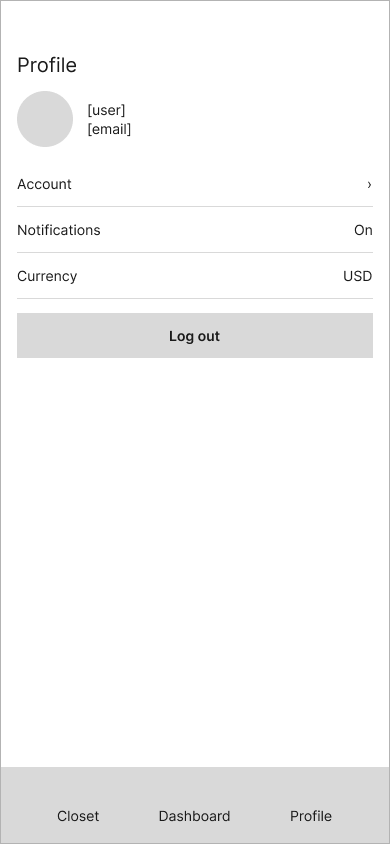

**Purpose:** Shows the user's account information and basic app settings.

- **Account** opens the user's account details.
- **Notifications** turns reminders on or off.
- **Currency** sets the currency used for prices and cost-per-wear.
- **Log out** signs the user out and returns them to the Welcome screen.

---

## Source Files

All source and exported files are in the [`ux-design`](ux-design/) directory:

- `app-map.png`: exported app map
- `wireframes/`: exported wireframe diagrams, numbered in the order shown above
- `figma-source.md`: links to the Figma source file and prototype, with a list of which Figma frame matches each PNG
